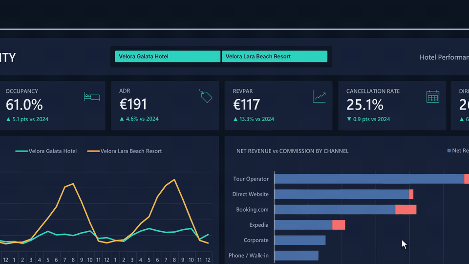
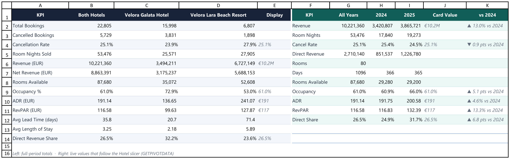
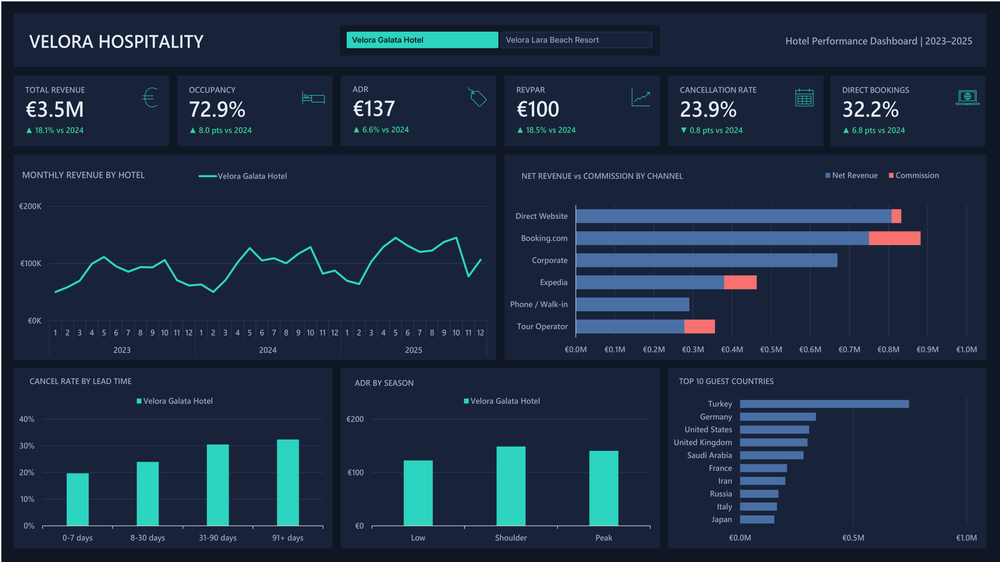
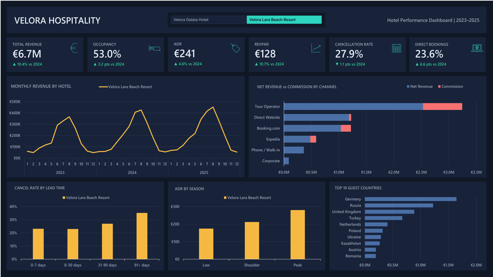

# Hotel Performance Dashboard (Excel)

An interactive performance dashboard for two hotels over three years, built entirely in Microsoft Excel with Tables, formulas, PivotTables and a slicer. No Power Query, no Power Pivot, no VBA.

**One click on a hotel and every KPI card and chart updates.**

---

## The business questions

A hotel group runs a city hotel in Istanbul and a beach resort in Antalya. Management wants one screen that answers:

1. How is revenue trending, and is the growth coming from price or volume?
2. How full are the hotels (occupancy), and what do we earn per available room (RevPAR)?
3. Which booking channels bring revenue, and which ones eat it through commission?
4. Who cancels, and does booking further ahead make cancellation more likely?
5. How do the two properties differ by season and by guest market?

## The data

| | |
|---|---|
| **Bookings** | 22,805 rows, one booking per row |
| **Period** | Arrivals from January 2023 to December 2025 |
| **Properties** | Velora Galata Hotel (city, 32 rooms) and Velora Lara Beach Resort (resort, 48 rooms) |
| **Raw columns** | 14: booking and arrival dates, nights, room type, guests, country, channel, customer type, meal plan, nightly rate, status |
| **Lookup tables** | Rooms per hotel and room type; commission % per booking channel |

> The dataset is **synthetic**, generated to behave like real hotel operations: bookings are capped by room inventory, demand is seasonal, and cancellation risk depends on channel and lead time. Hotel names and figures are fictional.

Raw data: [`data/velora_bookings_raw.xlsx`](data/velora_bookings_raw.xlsx) · [`data/velora_bookings_raw.csv`](data/velora_bookings_raw.csv)

## How it was built

**1. Data model with Excel Tables.** Raw bookings, rooms and channels are each a structured Table (`tblBookings`, `tblRooms`, `tblChannels`), so every formula and PivotTable grows with the data.

**2. 17 calculated columns** in `tblBookings`, using structured references:

| Column | Formula idea |
|---|---|
| Room Nights | `IF(Status = "Checked-Out", Nights, 0)`: only stays that happened fill a room |
| Revenue (EUR) | `Room Nights × Room Rate` |
| Channel Group, Commission % | `XLOOKUP` against `tblChannels` |
| Net Revenue (EUR) | `Revenue − Commission` |
| Season | `IFS` on month: Peak (Jun–Sep), Shoulder (Apr, May, Oct), Low |
| Lead Time Band | 0–7 / 8–30 / 31–90 / 91+ days between booking and arrival |
| Quarter, Year, Month, Stay Band, Is Cancelled, Total Guests, Direct Revenue | supporting fields for the PivotTables |

**3. KPI sheet with SUMIFS / COUNTIFS / AVERAGEIFS** for the full-period figures, with industry definitions:

- **Occupancy** = room nights sold ÷ room nights available (rooms × days)
- **ADR** (average daily rate) = revenue ÷ room nights sold
- **RevPAR** (revenue per available room) = revenue ÷ room nights available
- **Cancellation rate** = cancelled bookings ÷ all bookings
- **Direct share** = revenue from direct channels ÷ total revenue

**4. 10 PivotTables** feed the charts: monthly revenue by hotel, net revenue vs commission by channel, cancellation rate by lead time, ADR by season, and the top 10 guest countries by revenue.

**5. Live KPI cards with GETPIVOTDATA.** A single Hotel slicer is connected to every PivotTable. The KPI cards read the slicer-filtered totals through `GETPIVOTDATA`, detect which hotel is selected to compute the right room inventory, and build their "vs 2024" lines with `TEXT` and `UNICHAR` arrows. Changes are shown in **%** for money metrics and in **percentage points** for rates.

## Key insights

| KPI (2023–2025) | Value | 2025 vs 2024 |
|---|---|---|
| Total revenue | €10.2M | ▲ 13.0% |
| Occupancy | 61.0% | ▲ 5.1 pts |
| ADR | €191 | ▲ 4.6% |
| RevPAR | €117 | ▲ 13.3% |
| Cancellation rate | 25.1% | ▼ 0.9 pts |
| Direct revenue share | 26.5% | ▲ 6.8 pts |

1. **Growth came from filling rooms more than from raising prices.** RevPAR grew 13.3% while ADR grew only 4.6%; occupancy did most of the work.
2. **The earlier guests book, the more they cancel.** Cancellation rises from 20% for bookings made within a week of arrival to 35% for bookings made 91+ days ahead.
3. **Channel choice drives cancellations.** Booking.com bookings were cancelled 41.8% of the time, against 15.2% for the hotels' own website.
4. **Direct bookings are gaining ground.** The direct website's share of revenue rose from 15.3% (2023) to 24.9% (2025), while Booking.com fell from 23.1% to 17.4%, which means less commission paid.
5. **The resort depends on tour operators.** They bring the most revenue of any channel, and also the largest commission bill (€792K over three years).
6. **Two very different business models.** The city hotel runs at 72.9% occupancy with steady demand; the resort averages 53.0% but earns a higher ADR (€241) and its best month brings in about 8× its quietest one.

**Possible actions:** protect peak-season rates at the resort, tighten cancellation terms on long-lead OTA bookings, and keep shifting demand towards the direct website.

| City hotel selected | Resort selected |
|---|---|
|  |  |

## Files

| File | What it is |
|---|---|
| `Velora_Hotel_Dashboard.xlsx` | The full workbook: dashboard, KPI sheet, PivotTables, Tables and calculated columns |
| `data/velora_bookings_raw.xlsx` | Raw dataset with a data dictionary, before any formulas |
| `data/velora_bookings_raw.csv` | Same bookings as CSV, for SQL, Python or Power BI practice |
| `images/` | Screenshots and the demo GIF |

**To explore:** download the workbook, open the `Dashboard` sheet and click a hotel on the slicer at the top. Select both buttons to return to the portfolio view.

## Skills shown

Excel Tables · structured references · XLOOKUP · IF / IFS · SUMIFS / COUNTIFS / AVERAGEIFS · PivotTables and calculated fields · Show Values As (% of total, % difference) · GETPIVOTDATA · slicers and report connections · PivotCharts · dashboard layout and design · hotel KPIs (occupancy, ADR, RevPAR)

---

**Sultan Akoushali** · Data Analyst · [LinkedIn](https://www.linkedin.com/in/sultan-akoushali) · [Portfolio](https://sultan-akoushali.github.io)
